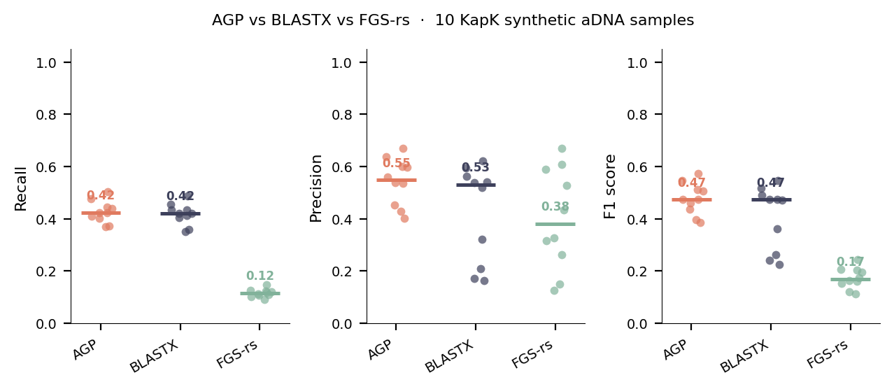
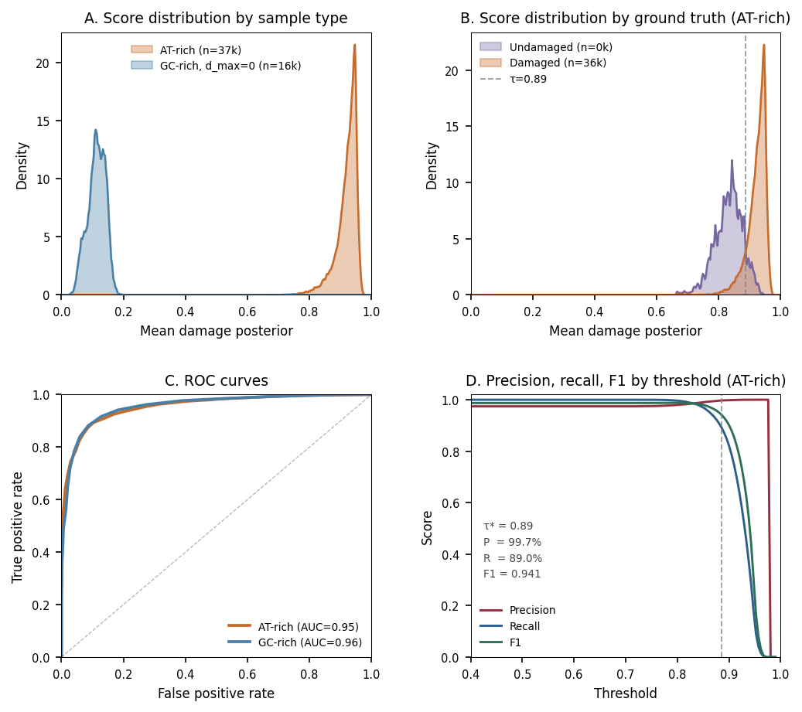
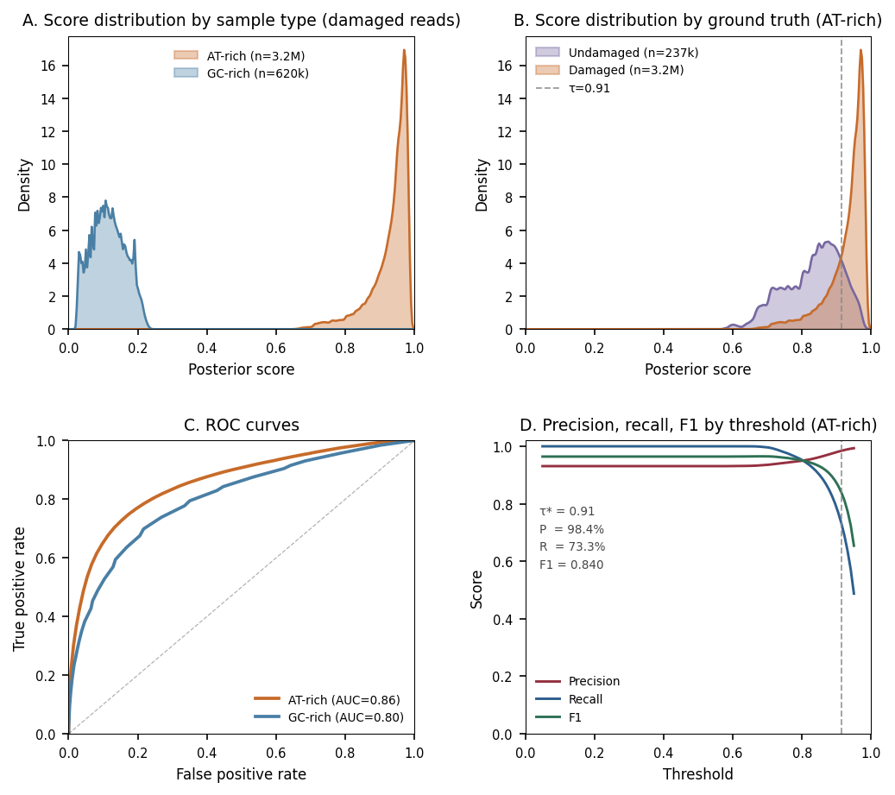

# DART: Damage-Aware Read Translation

[](https://opensource.org/licenses/MIT)
[](https://github.com/genomewalker/dart/releases/latest)
[](https://github.com/genomewalker/dart/actions/workflows/ci.yml)
[](https://anaconda.org/bioconda/dart-adna)

DART translates ancient DNA (aDNA) reads into proteins for functional annotation. It predicts protein-coding genes from short, degraded metagenomic sequences while accounting for post-mortem DNA damage that corrupts standard translation.

## Overview

<p align="center">

</p>

The pipeline runs in three stages. **Pass 1** scans all reads to measure the sample's damage level. **Pass 2** translates reads into proteins using that damage estimate to rescue genes that would otherwise be missed. **Functional annotation** searches those proteins against databases and scores each hit for authentic ancient damage.

Post-mortem deamination converts cytosines to uracil (read as T), producing C→T gradients at read termini. This breaks standard gene predictors by creating false stop codons. DART models the damage and corrects for it during translation; a second independent signal (stop codon conversion rates) validates that the enrichment is real damage rather than genomic T-richness. For full methods and model derivations, see the [wiki](https://github.com/genomewalker/dart/wiki/Methods-and-Model).

---

> **Status as of 2026-10-16** (`main`, unreleased since v1.1.0). Adds `ref-stats`, the joint EMI
> pipeline (`hits2emi-stream`, `emi-merge`, `emi-verify`), `simulate`, `eval` and `fit-calib`.
> EMI files are v7 (`hits2emi` writes it; older `.emi` files must be rebuilt). `predict` and
> `damage-annotate` now require explicit choices for the damage profile, the EM null model and the
> EM tape directory (see [Required choices](#required-choices)).

## Installation

Requires a C++20 compiler (GCC 10+ or Clang 12+), CMake 3.18+, zlib, zstd, ISA-L, NASM and
pkg-config. With conda:

```bash
conda env create -f environment.yml
conda activate dart
```

Or with system packages: `apt install zlib1g-dev libzstd-dev libisal-dev nasm pkg-config`
(macOS: `brew install zstd isa-l nasm pkg-config`). Then:

```bash
git clone https://github.com/genomewalker/dart.git
cd dart
cmake -S . -B build -DCMAKE_BUILD_TYPE=Release
cmake --build build -j
```

DART's damage estimates come from [libtaph](https://github.com/genomewalker/libtaph), pinned to an
exact commit. If a local checkout exists at `$REPOS/libtaph` (or `-DLIBTAPH_LOCAL_PATH=...`), it
must be at the pinned commit and clean, otherwise configure fails. With no local checkout, CMake
fetches the pinned commit from GitHub. `dart --version` prints the libtaph SHA.

---

## Quick start

DART ships a reproducible tutorial: 50,000 synthetic ancient DNA reads and the matched reference
proteins.

```bash
cd examples/tutorial
DART=../../build/dart DB=./ref_proteins.faa.gz bash run_tutorial.sh
```

It runs the four stages below in about 50 s and should end with:

```
Predicted genes:          147871
MMseqs2 hits:             45714
Damage-annotated reads:   8500
Ancient (posterior≥0.5):  6704
```

```bash
# 1) Predict genes + damage index
dart predict -i reads.fq.gz -o out/predictions.gff --fasta-aa out/proteins.faa \
  --damage-index out/predictions.agd --allow-self-profile -t 16

# 2) Search against reference proteins (VTML20 for short aDNA peptides)
mmseqs easy-search out/proteins.faa ref_proteins.faa.gz out/hits.tsv out/tmp \
  --search-type 1 --min-length 12 -e 10.0 --min-seq-id 0.86 -c 0.65 --cov-mode 2 \
  --sub-mat data/VTML20.out --seed-sub-mat data/VTML20.out \
  -s 2 -k 6 --spaced-kmer-pattern 11011101 \
  --format-output "query,target,fident,alnlen,mismatch,gapopen,qstart,qend,tstart,tend,evalue,bits,qlen,tlen,qaln,taln" \
  --threads 16

# 3) Build the EMI v7 index
dart hits2emi -i out/hits.tsv -o out/hits.emi --damage-index out/predictions.agd -t 16

# 4) EM assignment + damage annotation
dart damage-annotate --emi out/hits.emi --damage-index out/predictions.agd \
  -o out/annotated.tsv --gene-summary out/gene_summary.tsv \
  --auto-calibrate-spurious --no-null --em-tape-dir out/em_tape -t 16
```

The step-by-step walkthrough with real output is on the wiki:
[Quick Start Tutorial](https://github.com/genomewalker/dart/wiki/Quick-Start-Tutorial).
Use `--fasta-aa-masked` instead of `--fasta-aa` to replace damage-induced stop codons with `X` so
MMseqs2 can align across them.

### Required choices

| Command | You must pass | Why |
|---------|---------------|-----|
| `predict` | `--library-profile FILE` (fqdup library damage summary) or `--allow-self-profile` | Self-profiling is unreliable on deduplicated libraries |
| `damage-annotate` | `--em-null-model FILE` (fit with `--fit-null-from decoys.tsv`) or `--no-null` | Without a null model, reads from proteins absent from the database are force-mapped to the nearest homolog |
| `damage-annotate` (with `--no-null`) | `--em-tape-dir DIR` or `DART_EM_TAPE_DIR` | Without a null or calibration model, EM streams from an `O_DIRECT` tape; use node-local disk, not tmpfs. With `--em-null-model` EM runs in memory and needs no tape. |

The tutorial uses `--allow-self-profile` and `--no-null` because it has no library profile and its
reference contains exactly the proteins the reads hit.

### Damage profile only

```bash
dart profile reads.fq.gz -o profile.json
```

---

## Commands

| Command | Purpose |
|---------|---------|
| `predict` | Gene prediction + damage index (`.agd`) from reads |
| `profile` (`damage`) | Reference-free damage profile (JSON) |
| `hits2emi` | MMseqs2 16-column TSV → EMI v7 |
| `hits2emi-stream` | MMseqs2 result DBs → one EMI v7, streaming, for production-size searches |
| `emi-merge` | Union EMI v7 files over the same reads for joint EM across databases |
| `emi-verify` | Check EMI v7 invariants before annotation |
| `damage-annotate` | EM read assignment, per-read damage posteriors, per-protein authentication |
| `ref-stats` | Per-reference breadth, depth and identity for one sample (`--trim` for x-filter-comparable breadth) |
| `damage-info` | Print the damage profile stored in an `.agd` |
| `simulate` | Synthetic aDNA reads (Briggs model) with ground truth |
| `eval` | Score `predict` against `simulate` truth |
| `fit-calib` | Fit the coherent-LR EM calibration model from a labelled search |
| `damage-profile` | Terminal nucleotide profiles of protein-mapped reads |
| `validate` | Validate predictions against aMGSIM ground truth |

Every flag is documented in the
[Command Reference](https://github.com/genomewalker/dart/wiki/Command-Reference).

### Per-sample coverage

```bash
dart ref-stats --emi SAMPLE.emi --sample SAMPLE --out SAMPLE.cov.tsv --trim --threads 32
```

One row per reference: `sample_id ref_id ref_length n_reads n_alns breadth depth_mean avg_identity`.
`breadth` is covered positions / reference length (0–1). Libraries are never pooled. A 189 GB EMI
(15 B alignments, 52 M references) takes a few minutes and about 12 GB RSS on 32 threads; it reads
the whole file through the page cache, so run one large library per node.

### Production-scale EMI

```bash
dart hits2emi-stream targetDB db1.emi 32 manifest.txt     # manifest: "queryDB resultDB" per line
dart emi-merge joint.emi 32 db1.emi db2.emi
dart emi-verify joint.emi                                  # must print VERIFY: PASS
```

---

## Interpreting results

- **Per read** (`-o`): `posterior` combines terminal (`p_read`), substitution and identity evidence;
  `tier` says which evidence is present. EM columns (`gamma`, `em_keep`, `em_margin`,
  `em_ambiguous`, `em_reject_reason`) say how confidently the read was assigned; ambiguous reads
  do not count as damage evidence.
- **Per protein** (`--protein-summary`): the ancient call is `auth_binom_call`, a binomial test of
  damaged vs modern-rate reads. Trust it when `protein_auth_tier = detected`. A
  `library_not_authenticatable` warning means the library has no usable damage rate, so no protein
  can be called ancient.

Full guide: [Interpreting Results](https://github.com/genomewalker/dart/wiki/Interpreting-Results).
Column schemas: [Output Formats](https://github.com/genomewalker/dart/wiki/Output-Formats).

---

## Benchmark

### Gene prediction

Benchmarked on 18.3 million reads from 10 synthetic ancient DNA benchmark samples (v1.0.4). A prediction is correct if it matches any reference protein at ≥90% sequence identity.

| Method | Recall | Precision | Avg Identity |
|--------|--------|-----------|--------------|
| DART v1.0.4 | 67.6% | **97.2%** | **96.2%** |
| MMseqs2 blastx [Steinegger & Söding 2017] | **68.5%** | 96.3% | 94.8% |
| FGS-rs [Van der Jeugt et al. 2022] | 19.1% | 95.3% | 94.2% |

DART and BLASTX have equivalent functional recall (~68%), both far exceeding FGS-rs (19%), which treats damage-induced stop codons as real stops. DART produces 1.4% higher identity hits than BLASTX and runs ~1.5× faster (~35,000 reads/s, 8 threads).

#### v1.1.0 frame selection improvements

v1.1.0 improves internal frame selection accuracy substantially through a contrastive wrong-frame null model (log-likelihood ratio scoring), RC-strand null model for reverse-complement frames, and repaired-codon ancestor scoring at damage-induced stops. Benchmarked on 10 million simulated reads at four damage levels (no/low/medium/high):

| Damage level | Top-1 accuracy | vs v1.0.4 | Recall | vs v1.0.4 | Stop-read recall | vs v1.0.4 |
|---|---|---|---|---|---|---|
| None | 45.7% | +11.1% | 93.8% | +9.2% | 68.8% | +19.6% |
| Low | 47.9% | +15.1% | 93.8% | +9.3% | 69.1% | +20.1% |
| Medium | 52.1% | +18.3% | 93.3% | +7.8% | 69.1% | +15.1% |
| High | 51.4% | +12.5% | 92.7% | +8.1% | 70.7% | +16.9% |

MMseqs2 functional recall on one synthetic ancient DNA benchmark sample (4.4M reads): v1.1.0 = **62.6%** vs v1.0.4-adaptive = 63.0% (−0.4%), precision unchanged (92.7%). The marginal functional recall difference reflects fewer output candidates per read (3.5 vs 3.9) while the internal frame accuracy is +11–18% higher — correctly-ranked frames are less often diluted by wrong-frame candidates.

<p align="center">

</p>

### Damage classification

Protein-level damage classification benchmarked on the same 10 synthetic ancient DNA benchmark samples. Each protein is labelled ancient or modern based on the origin of its supporting reads (≥80% purity, ≥5 reads). Score: `assign_mean_posterior` from `damage-annotate`.

| Group | AUC-ROC |
|-------|---------|
| Overall | **0.881** |
| AT-rich samples | **0.957** |
| GC-rich samples | **0.943** |

At the Youden-optimal threshold τ = 0.70: **Precision 99.7%, Recall 89.5%, F1 = 0.943**.

<p align="center">

</p>

Read-level damage classification (per-read `posterior` score):

<p align="center">

</p>

Full benchmark details: [wiki/Benchmarks](https://github.com/genomewalker/dart/wiki/Benchmarks).

---

## Citation

If you use DART in your research, please cite:

> **Two-million-year-old microbial communities from the Kap København Formation in North Greenland**
> Fernandez-Guerra A, Wörmer L, Borrel G, et al.
> *bioRxiv* (2025)
> DOI: [10.1101/2023.06.10.544454](https://doi.org/10.1101/2023.06.10.544454)

```bibtex
@article{fernandezguerra2025,
  title={Two-million-year-old microbial communities from the Kap København Formation in North Greenland},
  author={Fernandez-Guerra, Antonio and W{\"o}rmer, Lars and Borrel, Guillaume and Delmont, Tom O and Elberling, Bo and Elvert, Marcus and Eren, A Murat and Gribaldo, Simonetta and Henriksen, Rasmus Amund and Hinrichs, Kai-Uwe and Jochheim, Annika and Korneliussen, Thorfinn S and Krupovic, Mart and Larsen, Nicolaj K and Perez-Laso, Rafael and Pedersen, Mikkel Winther and Pedersen, Vivi K and Ruter, Anthony H and Sand, Karina K and Sikora, Martin and Steinegger, Martin and Veseli, Iva and Wang, Yucheng and Zhao, Lei and {\v{Z}}ure, Marina and Kj{\ae}r, Kurt H and Willerslev, Eske},
  journal={bioRxiv},
  year={2025},
  doi={10.1101/2023.06.10.544454}
}
```

## References

- **Briggs et al. 2007.** Patterns of damage in genomic DNA sequences from a Neandertal. *PNAS* 104(37):14616–14621. [doi:10.1073/pnas.0704665104](https://doi.org/10.1073/pnas.0704665104)
- **Dempster et al. 1977.** Maximum likelihood from incomplete data via the EM algorithm. *J Royal Statistical Society B* 39(1):1–22.
- **Jónsson et al. 2013.** mapDamage2.0. *Bioinformatics* 29(13):1682–1684. [doi:10.1093/bioinformatics/btt193](https://doi.org/10.1093/bioinformatics/btt193)
- **Lindahl 1993.** Instability and decay of the primary structure of DNA. *Nature* 362:709–715. [doi:10.1038/362709a0](https://doi.org/10.1038/362709a0)
- **Michelsen et al. 2022.** metaDMG. *bioRxiv*. [doi:10.1101/2022.12.06.519264](https://doi.org/10.1101/2022.12.06.519264)
- **Müller & Vingron 2000.** Modeling amino acid replacement. *J Computational Biology* 7(6):761–776.
- **Steinegger & Söding 2017.** MMseqs2. *Nature Biotechnology* 35(11):1026–1028. [doi:10.1038/nbt.3988](https://doi.org/10.1038/nbt.3988)
- **Van der Jeugt et al. 2022.** FragGeneScanRs. *BMC Bioinformatics* 23(1):198. [doi:10.1186/s12859-022-04736-5](https://doi.org/10.1186/s12859-022-04736-5)
- **Varadhan & Roland 2008.** SQUAREM. *Scandinavian J Statistics* 35(2):335–353.

---

## License

MIT License; see LICENSE file for details.
