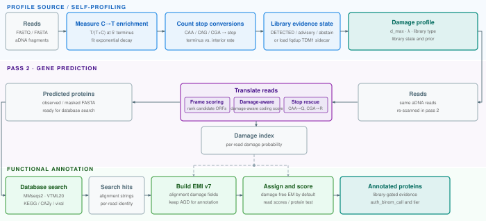

# DART: Damage-Aware Read Translation

[](https://opensource.org/licenses/MIT)
[](https://github.com/genomewalker/dart/releases/latest)
[](https://github.com/genomewalker/dart/actions/workflows/ci.yml)
[](https://anaconda.org/bioconda/dart-adna)

DART predicts protein-coding ORFs from ancient DNA reads, writes a damage index, and annotates protein-search alignments. Gene prediction, reference assignment and protein authentication are separate steps.

> Status as of 2026-10-21: checked against the v2.0.0 release branch (libtaph `c3b3a5d`).

The current main branch uses EMI v7. Damage-aware prediction requires an fqdup library damage summary or explicit self-profiling. `--em-use-damage-mapping` controls the joint damage E-step; protein authentication uses library-level damage information and assigned read evidence.

## Workflow

1. Run `predict` to write GFF3, protein FASTA and an AGD damage index.
2. Search the proteins with MMseqs2 and convert the hits to EMI v7.
3. Run `damage-annotate` for read assignments, damage scores and protein summaries.
4. Optionally run `ref-stats` for coverage of the input library.



## Installation

Requires a C++20 compiler (GCC 10+ or Clang 12+), CMake 3.18+, zlib, zstd, ISA-L, NASM and
pkg-config. With conda:

```bash
conda env create -f environment.yml
conda activate dart
```

Or with system packages: `apt install zlib1g-dev libzstd-dev libisal-dev nasm pkg-config`
(macOS: `brew install zstd isa-l nasm pkg-config`). Then:

```bash
git clone https://github.com/genomewalker/dart.git
cd dart
cmake -S . -B build -DCMAKE_BUILD_TYPE=Release
cmake --build build -j
```

DART's damage estimates come from [libtaph](https://github.com/genomewalker/libtaph), pinned to an
exact commit. If a local checkout exists at `$REPOS/libtaph` (or `-DLIBTAPH_LOCAL_PATH=...`), it
must be at the pinned commit and clean, otherwise configure fails. With no local checkout, CMake
fetches the pinned commit from GitHub. `dart --version` prints the libtaph SHA.

---

## Quick start

The bundled tutorial uses synthetic reads and matching reference proteins:

```bash
cd examples/tutorial
DART=../../build/dart DB=./ref_proteins.faa.gz bash run_tutorial.sh
```

For your own inputs you need two things the tutorial skips: a damage profile measured with
[fqdup](https://github.com/genomewalker/fqdup) on the reads before deduplication, and a null model
fitted from a decoy search, so reads from proteins missing from your database are not forced onto
the nearest homolog.

```bash
mkdir -p out
# 0) Damage profile from the merged reads, before deduplication
fqdup profile -i merged.fq.gz --damage-summary out/library.tdmg

# 1) Predict genes + damage index
dart predict -i reads.fq.gz -o out/predictions.gff --fasta-aa out/proteins.faa \
  --damage-index out/predictions.agd --library-profile out/library.tdmg -t 16

# 2) Search against reference proteins. VTML20 suits short aDNA peptides; the matrix
#    ships in examples/tutorial/data/ of the DART source tree
SEARCH=(--search-type 1 --min-length 12 -e 10.0 --min-seq-id 0.86 -c 0.65 --cov-mode 2
  --sub-mat examples/tutorial/data/VTML20.out --seed-sub-mat examples/tutorial/data/VTML20.out
  -s 2 -k 6 --spaced-kmer-pattern 11011101
  --format-output "query,target,fident,alnlen,mismatch,gapopen,qstart,qend,tstart,tend,evalue,bits,qlen,tlen,qaln,taln"
  --threads 16)
mmseqs easy-search out/proteins.faa ref_proteins.faa.gz out/hits.tsv out/tmp "${SEARCH[@]}"

# 3) Build the EMI v7 index
dart hits2emi -i out/hits.tsv -o out/hits.emi --damage-index out/predictions.agd -t 16

# 4) Null model: search the same proteins against the reversed reference proteins
#    with the same options, then fit the null from those decoy hits
seqkit seq -r ref_proteins.faa.gz > out/decoy_proteins.faa
mmseqs easy-search out/proteins.faa out/decoy_proteins.faa out/decoy_hits.tsv out/tmp "${SEARCH[@]}"
dart damage-annotate --fit-null-from out/decoy_hits.tsv --null-out out/null.tsv

# 5) EM assignment + damage annotation
dart damage-annotate --emi out/hits.emi --damage-index out/predictions.agd \
  --em-null-model out/null.tsv \
  -o out/annotated.tsv --gene-summary out/gene_summary.tsv \
  --auto-calibrate-spurious -t 16
```

The workflow and output interpretation are on the wiki:
[Quick Start Tutorial](https://github.com/genomewalker/dart/wiki/Quick-Start-Tutorial).
Use `--fasta-aa-masked` instead of `--fasta-aa` to replace damage-induced stop codons with `X` so
MMseqs2 can align across them.

### Required choices

| Command | You must pass | Why |
|---------|---------------|-----|
| `predict` | `--library-profile FILE` (binary TDM1 sidecar) or `--allow-self-profile` when damage detection is on | Self-profiling is unreliable on deduplicated libraries |
| `damage-annotate` | `--em-null-model FILE`, `--em-calib-model FILE`, or `--no-null` when EM is on | Without a null model, reads from proteins absent from the database are force-mapped to the nearest homolog |
| `damage-annotate` (with `--no-null`) | `--em-tape-dir DIR` or `DART_EM_TAPE_DIR` | With no audit, null/calibration model or damage-in-mapping flag, EM input uses an `O_DIRECT` tape; supply node-local disk supporting it. Other configurations do not require this tape. |

The tutorial opts into self-profiling and null-free EM for its bundled inputs. These choices do not establish that an arbitrary reference database contains every source protein. `predict --no-damage` does not require a profile; `damage-annotate --no-em` bypasses the EM null-model choice.

### Damage profile only

```bash
dart profile -i merged.fq.gz -o profile.json --damage-summary library.tdmg -t 16
```

`dart profile` and `fqdup profile` run the same profiler in libtaph and write byte-identical
JSON and `.tdmg` for the same reads and options. The `.tdmg` is what `predict --library-profile`
reads.

### Changes in v2.0.0

**Per-bin damaged fraction.** A length bin's `pi_damaged`, `pi_lo` and `pi_hi` used to need
`w_length > 0.5`, which amounted to a coin flip because `w_length` reads 0.500 to 0.502 in
every library. A bin now gets an interval when the damaged-read d_max clears the largest per-bin
δ by 1.96 standard errors. In our test set one library gained intervals and its library-level
`pi` narrowed from [0.35, 0.80] to [0.55, 0.59]. No library lost an interval it had before.

**`pi_authentic`.** New in each bin of `channels.bulk_damage.bins`: true when the bin has an
interval and `tau_discriminator` is DETECTED. The tau cutoffs (35 and 80 bp) were set on three
labelled libraries, so the flag is provisional. Check tau on libraries whose damage status you
already know before relying on it.

**`w_length` is deprecated.** It is still written but carries no information, since the longest
bin's profile curve is flat and swamps the slope's error. Use `tau_discriminator`. The
preservation terms that read it now use 0, so `qc.preservation.f_coh`, `evidence` and `score`
drop by up to 0.074, 0.27 and 0.18 against earlier builds. No call, d_max source, tau state or
interval count changes. Preservation is diagnostic only and its tier is null.

**tau length only when tau is detected.** `tau_discriminator.point` and
`burial_fingerprint.tau_hat` are null unless `tau_discriminator.state` is DETECTED. Without a
detection the curve is flat from 10 to 400 bp, and the reported length moved by more than 100 bp
between fits that agreed on everything else.

**Faster bulk fit.** The bulk damage fit now uses SQUAREM acceleration and needs a half to a
third of the sweeps on most libraries. Of the 7 test runs that used to stop at the 500-sweep cap,
6 now converge, and no final likelihood went down. On synthetic libraries built to mimic a
pervasive artifact, SQUAREM still stopped at the cap in 8 of 12, so expect some capped fits on
libraries like that.

**Capped fits give approximate curves.** tau and the short-bin pi interval read per-bin
profile-likelihood curves, and those are approximate when the main fit stops at the cap. One
test library still does; its likelihood is within 1e-5 of a 20,000-sweep reference. If
`channels.bulk_damage.converged` or a bin's `profile_converged` is false, treat tau and the
short-bin interval as approximate.

**gzip input.** All dart commands decode `.gz` with single-threaded ISA-L, as fqdup does. The
parallel rapidgzip decoder is gone: fqdup dropped it after it silently truncated a large input
on network storage. A `.gz` that ends mid-stream is now an error. `dart profile` peak memory on
a 2M-read library fell from 1.21 GB to 0.53 GB at `-t 32`.

**`.dcx` sort scratch.** `damage-annotate --dcx` sorts in memory up to 8 GiB and spills sorted
runs past that to `--em-tape-dir` (or `DART_EM_TAPE_DIR`). That directory must be on node-local
disk: NFS, tmpfs and `/tmp` are refused. The `dcx_streaming` test spills under `$TMPDIR`, so run
`ctest` with `TMPDIR` on node-local disk.

**`predict` output no longer depends on the thread count.** The periodic-codon model behind
Pass 2 trained on the first 50,000 eligible reads each thread happened to see, so two runs at
`-t 32` differed in about 0.05% of gene calls and in output order, and `-t 1` differed from
both. The training set is now up to 50,000 reads that are 60 to 200 bp after clipping, every
k-th such read across the whole input with k from the profile's read count, collected in file
order on one thread; genes are written in input order. Repeated runs at `-t 32` and a run at
`-t 1` are byte-identical. The sample costs one extra single-threaded decode of the input,
reported on stderr as `EM training set`.

---

## Commands

| Command | Purpose |
|---------|---------|
| `predict` | Gene prediction + damage index (`.agd`) from reads |
| `profile` (`damage`) | Reference-free damage profile (JSON) |
| `hits2emi` | MMseqs2 16-column TSV → EMI v7 |
| `hits2emi-stream` | MMseqs2 result DBs → one EMI v7, streaming, for production-size searches |
| `emi-merge` | Union EMI v7 files over the same reads for joint EM across databases |
| `emi-verify` | Check EMI v7 invariants before annotation |
| `damage-annotate` | EM read assignment, per-read damage posteriors, per-protein authentication |
| `ref-stats` | Per-reference breadth, depth and identity for one sample (`--trim` for x-filter-comparable breadth) |
| `damage-info` | Print the damage profile stored in an `.agd` |
| `simulate` | Synthetic aDNA reads (Briggs model) with ground truth |
| `eval` | Score `predict` against `simulate` truth |
| `fit-calib` | Fit the coherent-LR EM calibration model from a labelled search |
| `damage-profile` | Terminal nucleotide profiles of protein-mapped reads |
| `validate` | Validate predictions against aMGSIM ground truth |

Command flags and known help-text discrepancies are documented in the
[Command Reference](https://github.com/genomewalker/dart/wiki/Command-Reference).

### Per-sample coverage

```bash
dart ref-stats --emi SAMPLE.emi --sample SAMPLE --out SAMPLE.cov.tsv --trim --threads 32
```

One row per reference: `sample_id ref_id ref_length n_reads n_alns breadth depth_mean avg_identity`.
`breadth` is covered positions / reference length (0–1). `depth_mean` is aligned target residues / covered positions. Run `ref-stats` separately for each library; measure memory and I/O requirements on your own inputs.

### Production-scale EMI

```bash
dart hits2emi-stream targetDB db1.emi 32 manifest.txt     # manifest: "queryDB resultDB" per line
dart emi-merge joint.emi 32 db1.emi db2.emi
dart emi-verify joint.emi                                  # must print VERIFY: PASS
```

---

## Interpreting results

- **Per read** (`-o`): `posterior` combines terminal (`p_read`), substitution and identity evidence;
  `tier` says which evidence is present. EM columns (`gamma`, `em_keep`, `em_margin`,
  `em_ambiguous`, `em_reject_reason`) say how confidently the read was assigned; ambiguous reads
  do not count as damage evidence.
- **Per protein** (`--protein-summary`): the ancient call is `auth_binom_call`, a binomial test of
  damaged vs modern-rate reads. Trust it when `protein_auth_tier = detected`. A
  `library_not_authenticatable` warning means the library has no usable damage rate, so no protein
  can be called ancient.

Full guide: [Interpreting Results](https://github.com/genomewalker/dart/wiki/Interpreting-Results).
Column schemas: [Output Formats](https://github.com/genomewalker/dart/wiki/Output-Formats).

---

## Benchmarks

The [benchmark directory](benchmark/) contains evaluation scripts and retained results. The [wiki benchmark page](https://github.com/genomewalker/dart/wiki/Benchmarks) describes how to report a versioned comparison. Earlier release measurements are not performance or accuracy guarantees for the current model.

## Citation

If you use DART in your research, please cite:

> **Two-million-year-old microbial communities from the Kap København Formation in North Greenland**
> Fernandez-Guerra A, Wörmer L, Borrel G, et al.
> *bioRxiv* (2025)
> DOI: [10.1101/2023.06.10.544454](https://doi.org/10.1101/2023.06.10.544454)

```bibtex
@article{fernandezguerra2025,
  title={Two-million-year-old microbial communities from the Kap København Formation in North Greenland},
  author={Fernandez-Guerra, Antonio and W{\"o}rmer, Lars and Borrel, Guillaume and Delmont, Tom O and Elberling, Bo and Elvert, Marcus and Eren, A Murat and Gribaldo, Simonetta and Henriksen, Rasmus Amund and Hinrichs, Kai-Uwe and Jochheim, Annika and Korneliussen, Thorfinn S and Krupovic, Mart and Larsen, Nicolaj K and Perez-Laso, Rafael and Pedersen, Mikkel Winther and Pedersen, Vivi K and Ruter, Anthony H and Sand, Karina K and Sikora, Martin and Steinegger, Martin and Veseli, Iva and Wang, Yucheng and Zhao, Lei and {\v{Z}}ure, Marina and Kj{\ae}r, Kurt H and Willerslev, Eske},
  journal={bioRxiv},
  year={2025},
  doi={10.1101/2023.06.10.544454}
}
```

## References

- **Briggs et al. 2007.** Patterns of damage in genomic DNA sequences from a Neandertal. *PNAS* 104(37):14616–14621. [doi:10.1073/pnas.0704665104](https://doi.org/10.1073/pnas.0704665104)
- **Dempster et al. 1977.** Maximum likelihood from incomplete data via the EM algorithm. *J Royal Statistical Society B* 39(1):1–22.
- **Jónsson et al. 2013.** mapDamage2.0. *Bioinformatics* 29(13):1682–1684. [doi:10.1093/bioinformatics/btt193](https://doi.org/10.1093/bioinformatics/btt193)
- **Lindahl 1993.** Instability and decay of the primary structure of DNA. *Nature* 362:709–715. [doi:10.1038/362709a0](https://doi.org/10.1038/362709a0)
- **Michelsen et al. 2022.** metaDMG. *bioRxiv*. [doi:10.1101/2022.12.06.519264](https://doi.org/10.1101/2022.12.06.519264)
- **Müller & Vingron 2000.** Modeling amino acid replacement. *J Computational Biology* 7(6):761–776.
- **Steinegger & Söding 2017.** MMseqs2. *Nature Biotechnology* 35(11):1026–1028. [doi:10.1038/nbt.3988](https://doi.org/10.1038/nbt.3988)
- **Van der Jeugt et al. 2022.** FragGeneScanRs. *BMC Bioinformatics* 23(1):198. [doi:10.1186/s12859-022-04736-5](https://doi.org/10.1186/s12859-022-04736-5)

---

## License

MIT License; see LICENSE file for details.
